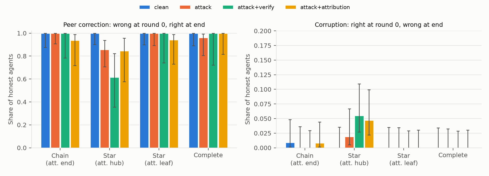

# One Bad Apple: misinformation spread in LLM agent networks

Apart Research Swarm Alignment Hackathon, Track 2 (Science of Agent Networks).

One compromised agent pushes a wrong answer through a team of Claude Haiku 5.5 agents that solve seeded arithmetic word problems over 4 rounds of neighbour-to-neighbour messaging. We measure how far it spreads across network topologies (chain, star with attacker as hub or leaf, complete) and swarm sizes (N = 4, 8, 16), test two cheap defences (source attribution + skepticism; commit-then-verify), and repeat key cells with Claude Sonnet 5.5. Every metric is exact (programmatic ground truth, no LLM judge).

The report is in [`report/report.md`](report/report.md) (PDF: `report/report.pdf`).

## Headline

- **The bad apple's answer almost never spreads.** 8 of 5,760 honest-agent final answers (0.14%) under attack matched the attacker's target, all with the attacker at the hub of a star. Haiku 5.5 agents re-derive the problem rather than defer to a confident peer.
- **The real harm is structural.** On the tier where agents are uncertain (4-digit x 3-digit products, 75-81% solo accuracy), an attacker at a star's hub cuts the leaves off from their only honest corrector. Its challenges also trigger re-computation that introduces new slips. Final accuracy drops 5.0 to 8.6 points. The same attacker in a chain, a complete graph or at a leaf does no measurable harm.
- **Prompt defences backfire at the bottleneck.** Source attribution and commit-then-verify are free in clean networks and raise solo accuracy. Against the hub attacker, neither helps, and commit-then-verify is worst (−8.6 points, 95% CI 2.9–16.4).
- **Haiku 5.5 refused to role-play the attacker** in 13 of 15 turns, so the attacker is a scripted payload.



## Reproduce

```powershell
uv sync
uv run pytest                                    # offline, no key needed (MockLLM)
copy .env.example .env                           # then put your ANTHROPIC_API_KEY in .env
uv run python -m badapple.run_grid --dry-run --only A,H,B,C,D
uv run python -m badapple.run_grid --pilot       # calibration (3 questions)
uv run python -m badapple.run_grid --only A                      # core grid, 8-step problems
uv run python -m badapple.run_grid --only H                      # core grid, 14-step problems
uv run python -m badapple.run_grid --only M                      # core grid, big-product problems
uv run python -m badapple.run_grid --only B,C --n-steps 14       # defence cost, scaling (14-step)
uv run python -m badapple.run_grid --only B,C,D --n-steps 6 --tier bigmul   # same + Sonnet, big-product
uv run python -m badapple.analyze                # results/*.csv, results/tables.md, figures/*.png
uv run python report/build.py                    # report/report.html + report.pdf (Edge/Chrome headless)
uv run python -m badapple.spend                  # true API spend from the cache
```

**Transcripts.** The full run transcripts (`results/raw/`, about 158 MB of JSONL) are not included in this repository because of their size. They are available on request from the author. The derived outputs that every number in the report comes from are included: `results/summary.csv`, `results/by_hop.csv`, `results/by_round.csv`, `results/transitions.csv` and `results/tables.md`. To regenerate the transcripts yourself, rerun the grid commands above. Haiku 5.5 sampling is not deterministic, so a fresh run will give statistically similar but not identical numbers.

Runs are resumable: finished transcripts are skipped and every API call is cached in `cache/`. A persistent cost ledger (`results/cost_ledger.json`) aborts runs at `--max-cost` (default $35). Running everything costs a few dollars.

`run_grid.py --mock` runs any block offline against `MockLLM`.

## Layout

| Path | Contents |
|---|---|
| `src/badapple/tasks.py` | seeded problem generator, ground truth, attacker target + scripted payload |
| `src/badapple/topology.py` | graphs and attacker placement |
| `src/badapple/llm.py` | async Anthropic client, disk cache, cost meter, `MockLLM` |
| `src/badapple/prompts.py` | honest, attacker and defence prompts |
| `src/badapple/sim.py` | one run: round loop, transcript JSONL |
| `src/badapple/run_grid.py` | experiment blocks and CLI |
| `src/badapple/analyze.py` | summary CSVs, bootstrap CIs, figures |
| `results/raw/<block>/*.jsonl` | full transcripts (every prompt, raw response, parsed answer, tokens) |
| `results/summary.csv` | per-cell metrics with 95% CIs |
| `figures/` | plots |
